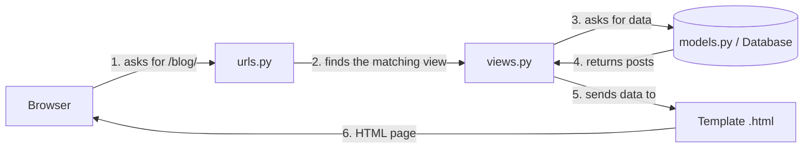
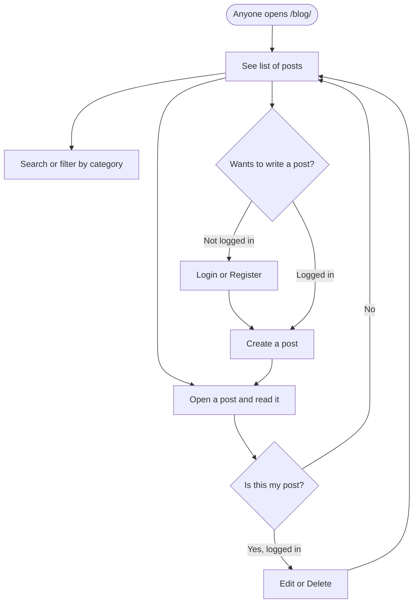
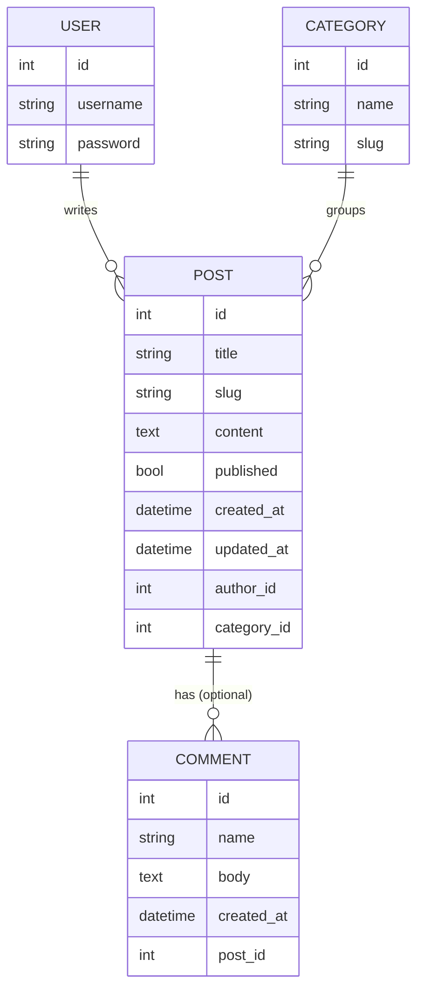
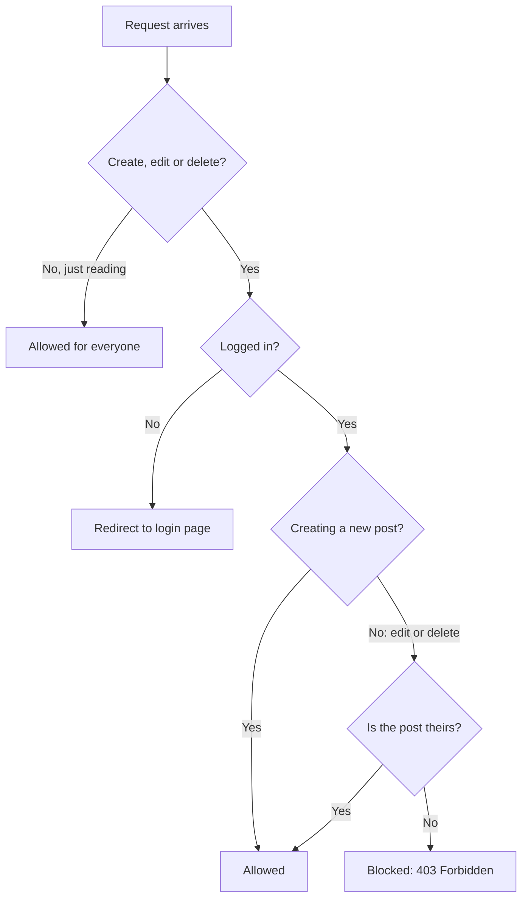
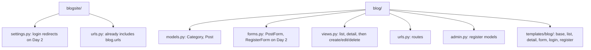
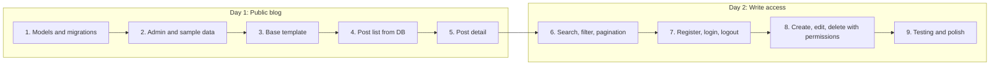

# Blog Project Plan: What We Are Going to Build

In the last guide we made a blog page with 3 **hardcoded** posts.
In this project we turn it into a **real blog**: posts live in a database, **anyone can read**,
and **logged-in users** can write, edit and delete their own posts.

**Time budget:** about 8 hours, split into days.

---

## 1. The Golden Rule

| Visitor type | Can do |
|--------------|--------|
| **Free visitor (not logged in)** | Read the list, open any post, search, filter by category |
| **Logged-in user** | Everything above **+ create** posts |
| **Author of a post** | Everything above **+ edit and delete** that post |

> Login is needed **only** to create, edit or delete. Reading is always free.

---

## 2. Features

| # | Feature | Who | Day |
|---|---------|-----|-----|
| 1 | Posts stored in a database | - | 1 |
| 2 | Categories | - | 1 |
| 3 | Public post list | Everyone | 1 |
| 4 | Public post detail page (`/blog/post/my-post/`) | Everyone | 1 |
| 5 | Admin panel | Superuser | 1 |
| 6 | Search, category filter, pagination | Everyone | 2 |
| 7 | Register / Login / Logout | Everyone | 2 |
| 8 | Create a post | Logged-in | 2 |
| 9 | Edit / Delete a post | Author only | 2 |
| 10 | My posts page | Logged-in | 2 |
| 11 | Anonymous comments (name + text) *(optional)* | Everyone | stretch |

---

## 3. The Big Picture: How a Request Flows

**In one line:** URL -> View -> Model -> Template -> Browser.

---

## 4. The User Journey

---

## 5. Database Design (Models)

- `USER` is Django's built-in model (we do not write it).
- One user has many posts. One category has many posts.
- `COMMENT` is optional (stretch goal). It has a `name` field because commenters are not logged in.

---

## 6. Pages and URLs

| URL | What it does | Who can open it |
|-----|--------------|-----------------|
| `/blog/` | Post list (search, filter, pages on Day 2) | **Everyone** |
| `/blog/post/<slug>/` | Post detail | **Everyone** |
| `/blog/new/` | Create post | Logged-in users |
| `/blog/post/<slug>/edit/` | Edit post | Author only |
| `/blog/post/<slug>/delete/` | Delete post | Author only |
| `/blog/mine/` | My posts | Logged-in users |
| `/blog/register/` | Sign up | Everyone |
| `/blog/login/`, `/blog/logout/` | Login, logout | Everyone |
| `/admin/` | Admin panel | Superuser |

---

## 7. Permission Rules (Quick Reference)

---

## 8. Files We Will Touch

---

## 9. Build Order

| Step | What you learn |
|------|----------------|
| 1. Models | `models.Model`, fields, `ForeignKey`, `makemigrations`, `migrate` |
| 2. Admin | `admin.site.register`, `createsuperuser` |
| 3. Base template | ``, `` |
| 4. List page | ``, ORM queries, `` |
| 5. Detail page | Slugs, `get_object_or_404` |
| 6. Search | `Q` objects, `request.GET`, `paginate_by` |
| 7. Auth | Built-in `LoginView`, `UserCreationForm`, `` |
| 8. CRUD | `ModelForm`, `CreateView`, `UpdateView`, `DeleteView`, `LoginRequiredMixin` |
| 9. Testing | Manual click-through, `tests.py` basics |

---

## 10. Out of Scope (Stretch Goals)

- Anonymous comments
- Image upload for posts (needs Pillow and media settings)
- Likes, tags, user profiles
- Bootstrap styling
- Deploying the site

---

## 11. Done Checklist

- [ ] A visitor who is **not logged in** can read the list and any post
- [ ] Can register, log in and log out
- [ ] Not-logged-in visitors are sent to login when they open `/blog/new/`
- [ ] Can create a post and see it in the list
- [ ] Can edit and delete my own post
- [ ] Cannot edit or delete someone else's post
- [ ] Search and category filter work
- [ ] Pagination appears with more than 5 posts
- [ ] Admin panel shows all models
