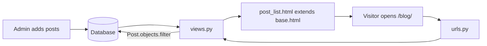
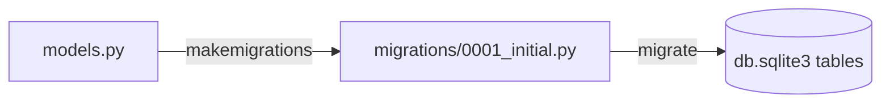
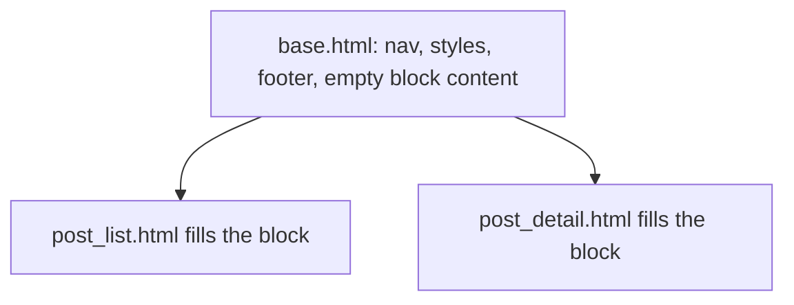
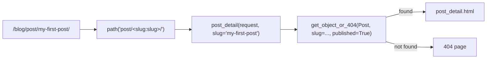
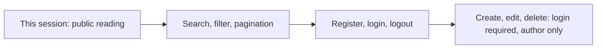

# Blog Project Guide

A step-by-step student guide to building a blog with Django.
By the end of this session, anyone (no login) can open `/blog/` and read posts that come from
a **database**. You add the posts from the Django admin panel.

> Reading comes first. Login, create, edit and delete come in the **next session**.

**Time:** about 3-4 hours.

---

## Table of Contents

- [1. Project at a Glance](#1-project-at-a-glance)
- [2. Setup and Commands](#2-setup-and-commands)
- [3. What Was Renamed](#3-what-was-renamed)
- [4. Words You Will Hear](#4-words-you-will-hear)
- [Step 1: Create the Models](#step-1-create-the-models)
- [Step 2: Admin Panel and Sample Data](#step-2-admin-panel-and-sample-data)
- [Step 3: Explore Data in the Django Shell](#step-3-explore-data-in-the-django-shell)
- [Step 4: The Base Template](#step-4-the-base-template)
- [Step 5: The Post List Page](#step-5-the-post-list-page)
- [Step 6: The Post Detail Page](#step-6-the-post-detail-page)
- [Step 7: Run the Tests and Wrap Up](#step-7-run-the-tests-and-wrap-up)
- [Common Mistakes](#common-mistakes)
- [If You Get Stuck](#if-you-get-stuck)
- [Exercises and Homework](#exercises-and-homework)
- [Quiz](#quiz)

---

## 1. Project at a Glance

| Thing | Name | What it is |
|-------|------|------------|
| Outer folder | `ismt_django` | The folder that holds everything |
| **Project** | `blogsite` | The whole website: settings, main `urls.py` |
| **App** `home` | `home` | The first welcome page (`/hello/`) |
| **App** `blog` | `blog` | The blog: models, views, templates (`/blog/`) |
| Virtual environment | `venv` | Our own private Python with Django installed |
| Database | `db.sqlite3` | A single file that stores the data (created by `migrate`) |

**Project vs app:** the *project* is the whole building. An *app* is one room (blog, home).
One project can have many apps.

```
ismt_django/
├── manage.py            <- the command tool (python manage.py ...)
├── blogsite/            <- PROJECT (settings.py, urls.py, wsgi.py, asgi.py)
├── home/                <- APP
├── blog/                <- APP
│   ├── models.py        <- shape of the data
│   ├── admin.py         <- admin panel setup
│   ├── views.py         <- fetch data, pick a template
│   ├── urls.py          <- app's URLs
│   ├── tests.py         <- automatic checks
│   ├── migrations/      <- history of database changes
│   └── templates/blog/  <- HTML files
├── docs/
└── venv/
```

### How a page is made



### Who can do what

| Visitor | Can do |
|---------|--------|
| Anyone (not logged in) | Read the list and every published post |
| Logged-in user *(next session)* | Create posts |
| Author of a post *(next session)* | Edit and delete that post |

---

## 2. Setup and Commands

### If you cloned this project (most students)

```bash
cd ismt_django
python3 -m venv venv                 # create the virtual environment (only once)
source venv/bin/activate             # turn it on. You will see (venv) in the prompt
pip install django                   # install Django (only once)
python manage.py check               # should say: System check identified no issues
```

On Windows, turn on the environment with `venv\Scripts\activate`.

### If you were starting from zero (how this project was created)

```bash
mkdir ismt_django && cd ismt_django
python3 -m venv venv
source venv/bin/activate
pip install django

django-admin startproject blogsite .   # create the PROJECT (the dot means "here")
python manage.py startapp blog         # create the blog APP
```

Then connect the app. In `blogsite/settings.py`, add it to `INSTALLED_APPS`:

```python
INSTALLED_APPS = [
    # ... Django's built-in apps ...
    'home',
    'blog',
]
```

In `blogsite/urls.py`, send `/blog/` to the app:

```python
from django.contrib import admin
from django.urls import path, include

urlpatterns = [
    path('admin/', admin.site.urls),
    path('', include('home.urls')),
    path('blog/', include('blog.urls')),
]
```

### Commands we use all the time

| Command | What it does |
|---------|--------------|
| `source venv/bin/activate` | Turn on the virtual environment (do this in every new terminal) |
| `python manage.py runserver` | Start the website at `http://127.0.0.1:8000/` (stop with Ctrl+C) |
| `python manage.py check` | Look for mistakes in the project |
| `python manage.py makemigrations blog` | Write a plan for the database change |
| `python manage.py migrate` | Apply the plan to the database |
| `python manage.py createsuperuser` | Create an admin login |
| `python manage.py shell` | Open Python with the project loaded (to play with data) |
| `python manage.py test blog` | Run the automatic tests |

---

## 3. What Was Renamed

The project was first created with the name `weblinks_site`. That name did not fit a blog,
so it was renamed to **`blogsite`**.

| Before | After |
|--------|-------|
| `weblinks_site/` (project folder) | `blogsite/` |
| `weblinks_site.settings` in `manage.py`, `wsgi.py`, `asgi.py` | `blogsite.settings` |
| `ROOT_URLCONF = 'weblinks_site.urls'` | `ROOT_URLCONF = 'blogsite.urls'` |
| `WSGI_APPLICATION = 'weblinks_site.wsgi.application'` | `'blogsite.wsgi.application'` |

How it was done:

```bash
git mv weblinks_site blogsite                                     # rename the folder (git keeps the history)
sed -i '' 's/weblinks_site/blogsite/g' manage.py blogsite/*.py    # replace the name inside the files
python manage.py check                                            # confirm nothing broke
```

(`sed -i ''` is the macOS form. On Linux use `sed -i`.)

Other changes made before this session:

- The 3 hardcoded posts in `blog/views.py` were **removed**. Posts now come from the database.
- Templates moved from `blog/templates/` to `blog/templates/blog/`. The extra `blog` folder stops two
  apps with a file named `index.html` from clashing.
- The outer folder `ismt_django` was **not** renamed, because the virtual environment remembers its path.

> If you ever rename a project, search for the old name with `grep -rn old_name .`
> and fix every match.

---

## 4. Words You Will Hear

| Word | Simple meaning |
|------|----------------|
| **Model** | A form template that says what information a post must have (title, text, author) |
| **Database** | A cupboard of filled-in forms |
| **Migration** | A work order: "add a new shelf to the cupboard" |
| **Admin panel** | The shopkeeper's back office where stock is added |
| **View** | The shop assistant: takes a request, fetches items, hands them over |
| **Template** | The shop window: how the items are displayed |
| **Base template** | The signboard and walls that are the same on every page |
| **Slug** | A readable URL name: `my-first-post` instead of `post-47` |
| **ForeignKey** | A "belongs to" link: each post belongs to one author and one category |
| **ORM** | A translator: you write Python, it talks SQL to the database |

---

## Step 1: Create the Models

A **model** is a Python class that describes one table in the database.
One class = one table. One attribute = one column.

Open `blog/models.py` and replace everything with:

```python
from django.conf import settings
from django.db import models
from django.urls import reverse
from django.utils.text import slugify


class Category(models.Model):
    name = models.CharField(max_length=50, unique=True)
    slug = models.SlugField(max_length=60, unique=True, blank=True)

    class Meta:
        verbose_name_plural = 'categories'
        ordering = ['name']

    def save(self, *args, **kwargs):
        if not self.slug:
            self.slug = slugify(self.name)
        super().save(*args, **kwargs)

    def __str__(self):
        return self.name


class Post(models.Model):
    title = models.CharField(max_length=200)
    slug = models.SlugField(max_length=220, unique=True, blank=True)
    author = models.ForeignKey(settings.AUTH_USER_MODEL, on_delete=models.CASCADE, related_name='posts')
    category = models.ForeignKey(Category, on_delete=models.SET_NULL, null=True, blank=True, related_name='posts')
    content = models.TextField()
    published = models.BooleanField(default=True)
    created_at = models.DateTimeField(auto_now_add=True)
    updated_at = models.DateTimeField(auto_now=True)

    class Meta:
        ordering = ['-created_at']

    def save(self, *args, **kwargs):
        if not self.slug:
            base = slugify(self.title) or 'post'
            slug, n = base, 2
            while Post.objects.filter(slug=slug).exists():
                slug = f'{base}-{n}'
                n += 1
            self.slug = slug
        super().save(*args, **kwargs)

    def get_absolute_url(self):
        return reverse('post_detail', kwargs={'slug': self.slug})

    def __str__(self):
        return self.title
```

### Understand it

| Piece | Meaning |
|-------|---------|
| `CharField(max_length=200)` | Short text (a title) |
| `TextField()` | Long text (the post body) |
| `SlugField` | URL-friendly text like `my-first-post` |
| `ForeignKey(Category, ...)` | "Each post belongs to **one** category." Many posts, one category |
| `ForeignKey(settings.AUTH_USER_MODEL, ...)` | "Each post has **one** author" (Django's built-in User) |
| `on_delete=models.CASCADE` | If the author is deleted, delete their posts too |
| `on_delete=models.SET_NULL` | If the category is deleted, keep the post but clear its category |
| `related_name='posts'` | Lets you write `user.posts.all()` and `category.posts.all()` |
| `auto_now_add=True` | Set the time **once**, when created |
| `auto_now=True` | Update the time **every** time it is saved |
| `ordering = ['-created_at']` | Newest first (the `-` means descending) |
| `save()` override | Creates the slug from the title if it is empty, and adds `-2`, `-3` if it already exists |
| `get_absolute_url()` | One place that knows a post's URL. Templates can use `post.get_absolute_url` |
| `__str__` | What shows up in the admin and the shell |

### Create the tables: migrations

A **migration** is a file that tells the database how to change.
It takes two commands:

```bash
python manage.py makemigrations blog   # 1. write the change plan (blog/migrations/0001_initial.py)
python manage.py migrate               # 2. apply it to db.sqlite3
```



> Every time you change `models.py`, run both commands again.

**Checkpoint:** `migrate` prints `Applying blog.0001_initial... OK`.

---

## Step 2: Admin Panel and Sample Data

Django gives you a ready-made admin site. We only have to tell it about our models.

Open `blog/admin.py`:

```python
from django.contrib import admin

from .models import Category, Post


@admin.register(Category)
class CategoryAdmin(admin.ModelAdmin):
    list_display = ('name', 'slug')
    prepopulated_fields = {'slug': ('name',)}


@admin.register(Post)
class PostAdmin(admin.ModelAdmin):
    list_display = ('title', 'author', 'category', 'published', 'created_at')
    list_filter = ('published', 'category')
    search_fields = ('title', 'content')
    prepopulated_fields = {'slug': ('title',)}
```

| Option | Effect |
|--------|--------|
| `list_display` | Columns shown in the list of posts |
| `list_filter` | Filter sidebar on the right |
| `search_fields` | Adds a search box |
| `prepopulated_fields` | Fills the slug automatically while you type the title |

Create your admin account and start the server:

```bash
python manage.py createsuperuser
python manage.py runserver
```

Open `http://127.0.0.1:8000/admin/`, log in, and add:

- **3 categories:** for example Travel, Tech, Food
- **5 posts:** give them different categories. Make one post **unpublished** (untick *Published*).
  We will use it to prove that drafts stay hidden.

---

## Step 3: Explore Data in the Django Shell

Before using the database in a view, play with it. This is the **ORM**:
you talk to the database using Python, not SQL.

```bash
python manage.py shell
```

```python
from blog.models import Post, Category

Post.objects.all()                              # every post
Post.objects.count()                            # how many
Post.objects.filter(published=True)             # only published
Post.objects.filter(title__icontains='trek')    # title contains "trek" (ignores case)
Post.objects.get(slug='my-first-post')          # exactly one (error if none or many)

p = Post.objects.first()
p.author.username                               # follow the ForeignKey to the User
p.category.name                                 # follow it to the Category

Category.objects.first().posts.all()            # all posts in a category (related_name!)
```

Type `exit()` to leave.

| Method | Returns |
|--------|---------|
| `.all()` | All rows |
| `.filter(...)` | Rows that match (can be empty) |
| `.get(...)` | One row. Crashes if there are 0 or 2+ |
| `.first()` | The first row or `None` |

---

## Step 4: The Base Template

Every page needs the same header and footer. Instead of copying them everywhere, we write
them **once** in a base template and let other pages **extend** it.



Create `blog/templates/blog/base.html`:

```html
<!DOCTYPE html>
<html lang="en">
<head>
  <meta charset="UTF-8">
  <meta name="viewport" content="width=device-width, initial-scale=1">
  <title>My Blog</title>
  <style>
    body { font-family: system-ui, sans-serif; max-width: 720px; margin: 0 auto; padding: 0 16px; color: #222; line-height: 1.6; }
    nav { display: flex; justify-content: space-between; align-items: center; padding: 16px 0; border-bottom: 1px solid #ddd; margin-bottom: 24px; }
    nav a { text-decoration: none; color: #0b57d0; margin-left: 16px; }
    nav .brand { font-weight: 700; font-size: 1.2rem; color: #222; margin-left: 0; }
    article { padding: 16px 0; border-bottom: 1px solid #eee; }
    article h2 { margin: 0 0 4px; }
    .meta { color: #666; font-size: 0.9rem; }
    .tag { background: #eef; padding: 2px 8px; border-radius: 10px; font-size: 0.8rem; }
    footer { color: #888; font-size: 0.85rem; margin: 32px 0; text-align: center; }
  </style>
</head>
<body>
  <nav>
    <a class="brand" href="">My Blog</a>
    <div>
      <a href="">Home</a>
    </div>
  </nav>

  

  <footer>Built with Django</footer>
</body>
</html>
```

| Tag | Meaning |
|-----|---------|
| `...` | A hole that child pages can fill |
| `` | Builds the URL from the route **name**, so you never hardcode `/blog/` |

---

## Step 5: The Post List Page

### The view

Open `blog/views.py` and replace everything:

```python
from django.shortcuts import get_object_or_404, render

from .models import Post


def blog_list(request):
    posts = Post.objects.filter(published=True).select_related('author', 'category')
    return render(request, 'blog/post_list.html', {'posts': posts})


def post_detail(request, slug):
    post = get_object_or_404(Post, slug=slug, published=True)
    return render(request, 'blog/post_detail.html', {'post': post})
```

- `filter(published=True)` is what hides drafts from visitors.
- `select_related('author', 'category')` fetches the author and category **in the same query**.
  Without it, the template would hit the database again for every post.
  (Look up "N+1 problem" if you want the full story.)

### The template

Create `blog/templates/blog/post_list.html`:

```html


All Posts | My Blog


  <h1>Latest Posts</h1>

  
    <article>
      <h2><a href="{{ post.get_absolute_url }}">{{ post.title }}</a></h2>
      <p class="meta">
        By {{ post.author.username }} on {{ post.created_at|date:"d M Y" }}
        <span class="tag">{{ post.category.name }}</span>
      </p>
      <p>{{ post.content|truncatewords:30 }}</p>
    </article>
  
    <p>No posts yet. Add some from the <a href="/admin/">admin panel</a>.</p>
  

```

| Syntax | Meaning |
|--------|---------|
| `` | "Use the base page as my frame" |
| `` | Loop, with a fallback when the list is empty |
| `{{ post.title }}` | Print a value |
| `{{ ...\|date:"d M Y" }}` | A **filter**: format the date as `17 Nov 2026` |
| `{{ ...\|truncatewords:30 }}` | Cut the text to 30 words |
| `` | Show the tag only if the post has a category |

---

## Step 6: The Post Detail Page

### The URL

Open `blog/urls.py`:

```python
from django.urls import path

from . import views

urlpatterns = [
    path('', views.blog_list, name='blog_list'),
    path('post/<slug:slug>/', views.post_detail, name='post_detail'),
]
```

`<slug:slug>` captures the part of the URL (like `my-first-post`) and passes it to the view
as the argument `slug`.



`get_object_or_404` returns the post, or shows a proper **404 Not Found** page instead of
crashing. Because we also pass `published=True`, nobody can open a draft by guessing its URL.

### The template

Create `blog/templates/blog/post_detail.html`:

```html


{{ post.title }} | My Blog


  <article>
    <h1>{{ post.title }}</h1>
    <p class="meta">
      By {{ post.author.username }} on {{ post.created_at|date:"d M Y" }}
      <span class="tag">{{ post.category.name }}</span>
    </p>
    <div>{{ post.content|linebreaks }}</div>
  </article>
  <p><a href="">&larr; Back to all posts</a></p>

```

`|linebreaks` turns blank lines in the text into paragraphs.

### Try it

Open `http://127.0.0.1:8000/blog/`, click a post title, then try `/blog/post/does-not-exist/`
(you should get a 404).

---

## Step 7: Run the Tests and Wrap Up

Open `blog/tests.py`:

```python
from django.contrib.auth.models import User
from django.test import TestCase
from django.urls import reverse

from .models import Category, Post


class BlogPublicTests(TestCase):
    @classmethod
    def setUpTestData(cls):
        cls.user = User.objects.create_user('roshan', password='pass12345')
        cls.cat = Category.objects.create(name='Travel')
        cls.post = Post.objects.create(title='Trek to Poon Hill', author=cls.user, category=cls.cat, content='Great views.')
        cls.draft = Post.objects.create(title='Secret Draft', author=cls.user, content='Hidden.', published=False)

    def test_slug_is_generated_and_unique(self):
        self.assertEqual(self.post.slug, 'trek-to-poon-hill')
        dup = Post.objects.create(title='Trek to Poon Hill', author=self.user, content='Again')
        self.assertEqual(dup.slug, 'trek-to-poon-hill-2')

    def test_list_is_public_and_hides_drafts(self):
        r = self.client.get(reverse('blog_list'))
        self.assertEqual(r.status_code, 200)
        self.assertContains(r, 'Trek to Poon Hill')
        self.assertNotContains(r, 'Secret Draft')

    def test_detail_is_public(self):
        r = self.client.get(self.post.get_absolute_url())
        self.assertEqual(r.status_code, 200)
        self.assertContains(r, 'Great views.')

    def test_unknown_slug_and_draft_return_404(self):
        self.assertEqual(self.client.get('/blog/post/nope/').status_code, 404)
        self.assertEqual(self.client.get(self.draft.get_absolute_url()).status_code, 404)
```

```bash
python manage.py test blog
```

Expected: `Ran 4 tests ... OK`. Django builds a **temporary empty database** for tests,
so your real posts are never touched.

### Checklist

- [ ] `python manage.py check` shows no issues
- [ ] `0001_initial.py` exists in `blog/migrations/`
- [ ] I can log in to `/admin/` and see Categories and Posts
- [ ] `/blog/` (while logged **out**) shows my published posts
- [ ] The unpublished post does **not** appear
- [ ] Clicking a title opens `/blog/post/<slug>/`
- [ ] A wrong slug shows a 404
- [ ] `python manage.py test blog` passes


---

## Common Mistakes

| Problem | Likely cause and fix |
|---------|----------------------|
| `no such table: blog_post` | You forgot `migrate` |
| Changed `models.py`, nothing changes | Run `makemigrations` **and** `migrate` again |
| `TemplateDoesNotExist` | The file must be in `blog/templates/blog/`, and the view must say `'blog/post_list.html'` |
| `NoReverseMatch` | The name in `` does not match `name=` in `urls.py` |
| List page is empty | No posts, or all are unpublished |
| Models missing in admin | `admin.py` not saved, or `@admin.register` missing |
| `ModuleNotFoundError: django` | The virtual environment is not active. Run `source venv/bin/activate` |
| Cannot log in to admin | Run `createsuperuser` again with a new username |
| Port already in use | Stop the other server with Ctrl+C, or use `runserver 8001` |

---

## If You Get Stuck

1. Read the **last line** of the error. It usually names the problem.
2. Is the server running? Does the prompt show `(venv)`?
3. Did you save the file?
4. Did you run `makemigrations` and `migrate`?
5. Is the template path exactly `blog/post_list.html`?
6. Do the route names match in `urls.py`, the view and ``?
7. Run `python manage.py check`.

---

## Exercises and Homework

**In class (pick one):**
1. Add a category called "Culture" and move two posts into it.
2. In the shell, print the titles of all posts in the Travel category.
   (`Post.objects.filter(category__name='Travel')`)
3. In the shell, print how many posts each category has.

**Homework:**
1. Add `summary = models.CharField(max_length=200, blank=True)` to `Post`. Run both migration commands.
   Show the summary on the list page instead of the shortened content.
2. Add an "About" page at `/blog/about/` that extends `base.html`, and link it from the nav.
3. Answer the quiz below.

---

## Quiz

1. What is the difference between `makemigrations` and `migrate`?
2. What does `on_delete=models.CASCADE` do? When would you use `SET_NULL` instead?
3. Why do we pass `published=True` to `get_object_or_404`?
4. What does `` do, and what is `` for?
5. What does `related_name='posts'` allow you to write?
6. Why is `` better than writing `/blog/`?
7. What is the difference between a project and an app?
8. Who can read posts on our blog today? Who will be able to create them next session?

## Next Session


