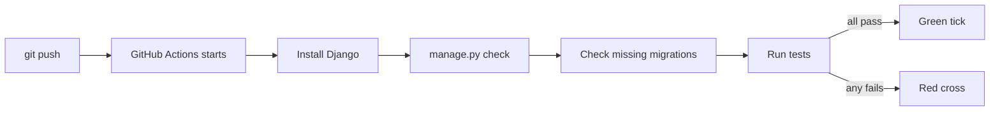

# CI Demo with GitHub Actions

**CI (Continuous Integration)** = every time you push code, a robot checks it automatically.
No more "it works on my laptop".



## What was added

| File | Purpose |
|------|---------|
| `requirements.txt` | Tells the robot what to install (`Django==6.1.2`) |
| `.github/workflows/ci.yml` | The robot's instructions |

## What the robot does (`ci.yml`)

| Step | Command | Catches |
|------|---------|---------|
| Install | `pip install -r requirements.txt` | Missing packages |
| Check project | `python manage.py check` | Config mistakes |
| Missing migrations | `python manage.py makemigrations --check --dry-run` | Changed `models.py` but forgot `makemigrations` |
| Tests | `python manage.py test` | Broken features |

It runs on every push to `main` and on every pull request.

## Demo (about 10 minutes)

1. **Green:** push the project. Open the repo's **Actions** tab and watch the run turn green.
2. **Red (tests):** in `blog/tests.py` change `200` to `201` in `test_list_is_public_and_hides_drafts`.
   Commit and push. The run turns red. Open it and show the failed step and error message.
3. **Fix:** change it back, push again, green.
4. **Red (migration):** add a field to `Post` in `models.py` without running `makemigrations`.
   Push. The "missing migrations" step fails.
5. **Pull request (optional):** do step 2 on a branch and open a PR. The PR shows the failed check
   before anything is merged.

## Run the same checks on your laptop

```bash
python manage.py check
python manage.py makemigrations --check --dry-run
python manage.py test
```

If these pass locally, CI will pass too.

## Note

CI uses Python 3.12 because Django 6.1 needs 3.12 or newer. If your project uses another
Django version, change the number in `requirements.txt` to match.
