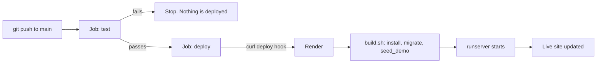

# CD Demo: Auto-Deploy to Render

**CD (Continuous Deployment)** = when the tests pass, the new version goes live automatically.

> This is a **test/dev** deployment. It runs Django's own `runserver` with `DEBUG = True`,
> and the data resets on every deploy. It is perfect for a demo, not for a real production site.

## What was added

| File | Purpose |
|------|---------|
| `.github/workflows/ci.yml` | New `deploy` job. It runs only after `test` passes, and only on pushes to `main` |
| `build.sh` | Render runs it on every deploy: install, `migrate`, `seed_demo` |
| `blog/management/commands/seed_demo.py` | Creates an admin user and 3 sample posts (safe to run many times) |
| `blogsite/settings.py` | Allows Render's hostname in `ALLOWED_HOSTS` |

Why `seed_demo`? Render's free plan has no shell, and the database is wiped on every deploy.
Without it, the live site would be empty and you could not log in.

## One-time setup

### 1. Render
1. Sign up at render.com (signing in with GitHub is easiest).
2. **New > Web Service**, connect GitHub, pick the `ismt` repo.
3. Fill in:
   - **Language:** Python 3
   - **Branch:** `main`
   - **Build Command:** `./build.sh`
   - **Start Command:** `python manage.py runserver 0.0.0.0:$PORT --noreload`
   - **Instance type:** Free
4. Add **Environment Variables**:

   | Name | Value |
   |------|-------|
   | `PYTHON_VERSION` | A full Python 3.12 or newer version (Django 6.1 needs it; check Render's docs for accepted values) |
   | `DEMO_ADMIN_USER` | Any username, e.g. `demoadmin` |
   | `DEMO_ADMIN_PASSWORD` | A password you choose (do not reuse a real one) |

5. **Create Web Service** and wait for the first build. You get a URL like `yourname.onrender.com`.
6. Open the service **Settings** and set **Auto-Deploy** to **Off** (so only GitHub Actions deploys).
7. In **Settings > Deploy Hook**, copy the URL. Treat it like a password.

### 2. GitHub
Repo **Settings > Secrets and variables > Actions > New repository secret**:
- Name: `RENDER_DEPLOY_HOOK_URL`
- Value: the deploy hook URL

> Push `ci.yml` only after this secret exists, otherwise the `deploy` job fails.

## Demo script (about 10 minutes)

1. **Deploy:** push a small change (for example the footer text). In **Actions** watch `test` go green,
   then `deploy` go green. In Render's **Events/Logs** a new deploy starts.
2. **Show it live:** open `https://yourname.onrender.com/blog/` and see the 3 sample posts.
   Log in at `/admin/` with the demo admin account.
3. **Prove the gate:** break a test (for example set `self.slug = self.name` in `Category.save()`), push.
   `test` goes red and `deploy` shows **skipped**. Refresh the live site: it is unchanged.
4. **Fix:** `git revert HEAD --no-edit && git push`. Both jobs go green again.

## Things to know

- **Cold start:** the free site sleeps after 15 minutes without visitors and takes about a minute to wake. Open it before class.
- **Data resets:** posts added on the live site disappear on the next deploy. Only the seeded sample data comes back.
- **If the deploy job fails with a curl error:** check the `RENDER_DEPLOY_HOOK_URL` secret. If the hook seems to be ignored while Auto-Deploy is Off, switch Auto-Deploy to **After CI Checks Pass** and remove the `deploy` job.
- **Not for production:** a real site would use gunicorn, `DEBUG = False`, a real database and a secret key from the environment.
