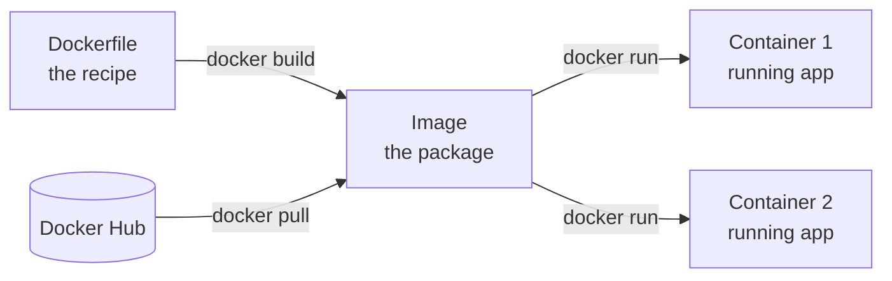
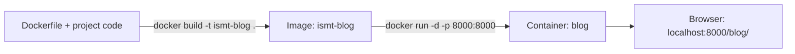
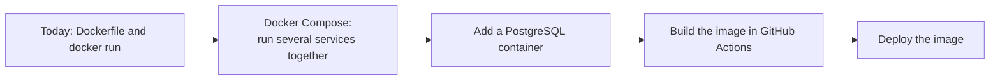

# Docker Basics: From Setup to Everyday Use

A beginner guide to Docker, using our Django blog as the example.
By the end you can install Docker, run a container, build an image of the blog, and run the blog
inside Docker.

---

## Table of Contents

- [1. What Is Docker?](#1-what-is-docker)
- [2. Install and Check Docker](#2-install-and-check-docker)
- [3. Your First Container](#3-your-first-container)
- [4. Everyday Commands](#4-everyday-commands)
- [5. Put the Blog in Docker](#5-put-the-blog-in-docker)
- [6. Editing Code While the Container Runs](#6-editing-code-while-the-container-runs)
- [7. Where Does the Data Live?](#7-where-does-the-data-live)
- [8. Common Mistakes](#8-common-mistakes)
- [9. Cheat Sheet](#9-cheat-sheet)
- [10. Exercises](#10-exercises)
- [11. Quiz](#11-quiz)

---

## 1. What Is Docker?

**The problem:** "It works on my laptop" but not on yours. Different Python version, missing packages,
different operating system.

**The idea:** pack the app **and everything it needs** into one box. That box runs the same way on
every computer that has Docker.

| Word | Simple meaning |
|------|----------------|
| **Image** | A recipe plus ingredients, frozen. A read-only package with Python, Django and our code |
| **Container** | A running copy made from an image, like a cooked meal from the recipe |
| **Dockerfile** | The recipe: a text file with steps to build an image |
| **Registry** (Docker Hub) | An online store of images. `python:3.12-slim` comes from there |
| **Volume / bind mount** | A way to share a folder between your computer and the container |
| **Port mapping** | A door from your computer into the container, e.g. `8000:8000` |



**One image can start many containers.** Deleting a container does not delete the image.

### Docker vs a virtual machine

| | Virtual machine | Docker container |
|---|---|---|
| Contains | A whole operating system | Only the app and its libraries |
| Size | Gigabytes | Megabytes to a few hundred MB |
| Start time | Minutes | Seconds |

### Why it fits our project
- Same Python version for every student (our CI uses Python 3.12 because Django 6.1 needs 3.12 or newer).
- No `venv` setup problems.
- The same image can later be used for deployment.

---

## 2. Install and Check Docker

### macOS
1. Download **Docker Desktop** from docker.com (choose Apple Silicon or Intel to match your Mac).
2. Open the downloaded file, drag Docker to Applications, and start it.
3. Wait until the whale icon in the menu bar says Docker is running.

(Homebrew users can also run `brew install --cask docker`.)

### Windows
1. Install **Docker Desktop** from docker.com.
2. Keep the **WSL 2** option ticked during installation.
3. Restart if asked, then start Docker Desktop.

### Linux (Ubuntu)
Follow the official steps at docs.docker.com/engine/install/ubuntu, then optionally allow your user to
run Docker without `sudo`:
```bash
sudo usermod -aG docker $USER      # log out and in again afterwards
```

### Check that it works
```bash
docker --version         # prints the version
docker info              # if this prints details, the Docker engine is running
```

> If `docker info` says it cannot connect to the daemon, **Docker Desktop is not running**. Start it first.

---

## 3. Your First Container

```bash
docker run hello-world
```

What happens:
1. Docker looks for the image `hello-world` on your computer. It is not there.
2. It **pulls** (downloads) it from Docker Hub.
3. It creates a **container** and runs it. It prints a message and stops.

Now try something more useful, an interactive Python container:

```bash
docker run -it --rm python:3.12-slim python
```

| Flag | Meaning |
|------|---------|
| `-it` | Interactive, with a terminal so you can type |
| `--rm` | Delete the container when it stops (keeps things tidy) |
| `python:3.12-slim` | The image. `python` is the name, `3.12-slim` is the **tag** (version) |
| `python` (last word) | The command to run inside the container |

You get a Python prompt without installing Python on your computer. Type `exit()` to leave.

---

## 4. Everyday Commands

### Images
| Command | What it does |
|---------|--------------|
| `docker pull python:3.12-slim` | Download an image |
| `docker images` | List images on your computer |
| `docker build -t ismt-blog .` | Build an image from the Dockerfile in this folder and name it `ismt-blog` |
| `docker rmi ismt-blog` | Delete an image |

### Containers
| Command | What it does |
|---------|--------------|
| `docker run ismt-blog` | Create and start a container (runs in your terminal) |
| `docker run -d -p 8000:8000 --name blog ismt-blog` | Run in the **background** (`-d`), map port 8000, name it `blog` |
| `docker ps` | List running containers |
| `docker ps -a` | List all containers, including stopped ones |
| `docker logs blog` | Show a container's output |
| `docker logs -f blog` | Follow the logs live (stop with Ctrl+C) |
| `docker stop blog` | Stop a container |
| `docker start blog` | Start a stopped container again |
| `docker restart blog` | Stop and start |
| `docker rm blog` | Delete a stopped container |
| `docker rm -f blog` | Stop and delete in one step |
| `docker exec -it blog bash` | Open a terminal **inside** a running container (type `exit` to leave) |
| `docker exec blog python manage.py check` | Run one command inside a running container |

### Cleaning up
| Command | What it does |
|---------|--------------|
| `docker system df` | Show how much space Docker uses |
| `docker container prune` | Delete all stopped containers |
| `docker image prune` | Delete unused images |

> `prune` commands ask for confirmation. Read what they will delete before you say yes.

### Port mapping explained
```
docker run -p 8000:8000 ismt-blog
              |    |
              |    +-- port inside the container (where Django listens)
              +------- port on YOUR computer (what you type in the browser)
```
`-p 9000:8000` means: open `http://localhost:9000` on your computer to reach port 8000 in the container.

---

## 5. Put the Blog in Docker

We create two small files in the project folder (next to `manage.py`).

### Step 1: `Dockerfile`

```dockerfile
# Start from an image that already has Python installed
FROM python:3.12-slim

# Python settings: no .pyc files, show logs immediately
ENV PYTHONDONTWRITEBYTECODE=1 \
    PYTHONUNBUFFERED=1

# Work inside /app in the container
WORKDIR /app

# Install packages first (Docker reuses this step if requirements.txt did not change)
COPY requirements.txt .
RUN pip install --no-cache-dir -r requirements.txt

# Copy the project code
COPY . .

# The site listens on port 8000 inside the container
EXPOSE 8000

# Create the tables, then start the development server
CMD ["sh", "-c", "python manage.py migrate && python manage.py runserver 0.0.0.0:8000"]
```

| Line | What it does |
|------|--------------|
| `FROM` | The starting image (Python 3.12, slim version) |
| `ENV` | Sets environment variables |
| `WORKDIR` | The folder inside the container where commands run |
| `COPY requirements.txt .` | Copy one file in, so the install step can be cached |
| `RUN` | A command that runs **while building** the image |
| `COPY . .` | Copy the whole project into `/app` |
| `EXPOSE` | Documents which port the app uses (it does not open the port by itself) |
| `CMD` | The command that runs **when a container starts** |

**`RUN` vs `CMD`:** `RUN` happens once at build time. `CMD` happens every time a container starts.

**Why copy `requirements.txt` first?** Docker builds in layers and caches each one. Packages change rarely and code
changes often. With this order, a code change does not reinstall all the packages.

### Step 2: `.dockerignore`

```
venv/
.git/
__pycache__/
*.pyc
db.sqlite3
.DS_Store
```

It works like `.gitignore`: files listed here are **not** copied into the image. We skip `venv/` (the
container has its own Python) and `db.sqlite3` (the container creates its own database).

### Step 3: Build the image
Run this in the folder that contains the `Dockerfile`:
```bash
docker build -t ismt-blog .
```
The `.` at the end means "use this folder". The first build downloads Python, so it takes a minute. Check it:
```bash
docker images
```
You should see `ismt-blog`.

### Step 4: Run the container
```bash
docker run -d -p 8000:8000 --name blog ismt-blog
```
Open `http://localhost:8000/blog/` in your browser. The page will say there are no posts yet. That is normal:
the container has a fresh, empty database (see section 7).

### Step 5: Look around
```bash
docker ps                  # is it running?
docker logs blog           # Django's output
docker exec blog python manage.py check
docker exec blog python manage.py test
```

Create an admin user and add posts:
```bash
docker exec -it blog python manage.py createsuperuser
```
Then open `http://localhost:8000/admin/`.

### Step 6: Stop and remove
```bash
docker stop blog
docker rm blog
```

### Flow of what we just did


> **This runs Django's development server.** It is fine for learning and testing, not for a real production site.

---

## 6. Editing Code While the Container Runs

By default the code is **copied** into the image, so editing a file on your computer does not change a
running container. Two choices:

**Option A: rebuild after every change** (slow but simple)
```bash
docker rm -f blog
docker build -t ismt-blog .
docker run -d -p 8000:8000 --name blog ismt-blog
```

**Option B: share your project folder with the container** (a *bind mount*)
```bash
docker run -d -p 8000:8000 -v "$(pwd)":/app --name blog ismt-blog
```
`-v "$(pwd)":/app` means: show my current folder inside the container as `/app`. When you save a file, the
container sees it, and Django's development server reloads by itself. Give it a few seconds to start; if the page
does not load, run `docker logs blog` to see why.

With a bind mount the database file `db.sqlite3` is created in **your project folder** (it is already ignored by git).

On Windows PowerShell use `-v "${PWD}:/app"` instead of `-v "$(pwd)":/app`.

---

## 7. Where Does the Data Live?

A container has its own temporary file system. If you delete the container, **everything created inside it is lost**,
including a SQLite database stored there.

```
Container A: create admin + posts  ->  docker rm  ->  Container B: empty database again
```

| If you want data to survive | Use |
|------------------------------|-----|
| While developing | A bind mount (`-v "$(pwd)":/app`), as in section 6 |
| A named volume managed by Docker | `-v blogdata:/app/data` (needs the database path to point there) |
| A real project | A separate database container or service (PostgreSQL, for example) |

For learning, the bind mount is enough. Remember this when you wonder why your posts disappeared.

---

## 8. Common Mistakes

| Problem | Likely cause and fix |
|---------|----------------------|
| `Cannot connect to the Docker daemon` | Docker Desktop is not running. Start it |
| `port is already allocated` | Something else uses port 8000. Stop it, or use `-p 8001:8000` and open port 8001 |
| Browser shows "can't connect" | Missing `-p 8000:8000`, or the container exited. Check `docker ps -a` and `docker logs blog` |
| `container name "/blog" is already in use` | An old container has that name. `docker rm -f blog`, then run again |
| Image is huge or the build is slow | `.dockerignore` is missing, so `venv/` was copied in |
| My code change does not show | The code was copied at build time. Rebuild, or use a bind mount (section 6) |
| Posts and admin user disappeared | The container was deleted, so its database went with it (section 7) |
| `no such table` errors | The migrations did not run. Our `CMD` runs `migrate` on every start, so check `docker logs blog` |
| `Dockerfile` not found | You are in the wrong folder, or the file has an extension like `.txt` |
| `Bad Request (400)` on another hostname | `ALLOWED_HOSTS` is empty. `localhost` works, other hosts need adding in `settings.py` |

---

## 9. Cheat Sheet

```bash
# Check
docker --version
docker info

# Images
docker pull python:3.12-slim
docker build -t ismt-blog .
docker images
docker rmi ismt-blog

# Run
docker run -d -p 8000:8000 --name blog ismt-blog
docker run -d -p 8000:8000 -v "$(pwd)":/app --name blog ismt-blog   # with live code

# Inspect
docker ps
docker ps -a
docker logs -f blog

# Work inside
docker exec -it blog bash
docker exec -it blog python manage.py createsuperuser

# Stop and clean
docker stop blog
docker start blog
docker rm -f blog
docker container prune
docker image prune
```

---

## 10. Exercises

1. Run `docker run -it --rm python:3.12-slim python` and print `2 + 2`.
2. Build the blog image and open `/blog/` in your browser.
3. Create a superuser inside the container and add a post in `/admin/`. Then run `docker rm -f blog`, start a new
   container, and check that your post is gone. Explain why.
4. Run the container on port 9000 instead of 8000.
5. Run `docker exec blog python manage.py test` and read the output.
6. Change the `<h1>` text in `post_list.html`, rebuild the image, and confirm the change shows up.
7. Do exercise 6 again with a bind mount, without rebuilding. What is different?

---

## 11. Quiz

1. What is the difference between an image and a container?
2. What does `-p 8000:8000` do? Which number is which?
3. What is the difference between `RUN` and `CMD` in a Dockerfile?
4. Why do we copy `requirements.txt` before copying the rest of the code?
5. What is `.dockerignore` for?
6. You deleted a container and your posts are gone. Why?
7. What does `docker exec -it blog bash` do?
8. Name two ways to see why a container stopped unexpectedly.

---

## What Comes Next


